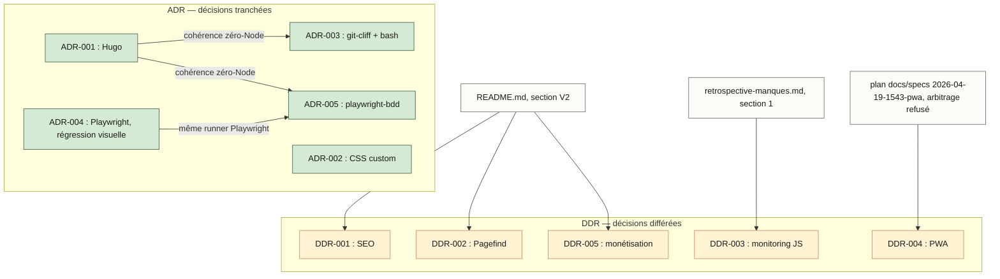

# MAP — Carte des décisions Kanpai Ø

Vue synthétique des ADR et DDR et des sources dont elles sont issues.
Graphe volontairement petit (5 ADR + 5 DDR) — pas d'outillage dédié, un
simple flowchart Mermaid mis à jour à la main.

## Légende

- **Vert** = ADR tranchée (`docs/adr/`). **Jaune pâle** = DDR différée
  (`docs/ddr/`). **Blanc** = document source (plan, README, rétrospective).
- Flèche entre deux ADR = cohérence ou dépendance technique explicite.
- Flèche depuis un document source = décision issue de ce document.

Détail de chaque lien :

| Lien | Raison |
|---|---|
| ADR-001 → ADR-003, ADR-001 → ADR-005 | Cohérence zéro-Node : les deux décisions ultérieures maintiennent l'absence de pipeline Node au runtime actée par ADR-001. |
| ADR-004 → ADR-005 | Même runner Playwright : ADR-005 (BDD) réutilise directement l'outillage posé par ADR-004 (régression visuelle). |
| Plan `docs/specs/2026-04-19-1543-pwa` → DDR-004 | La DDR est formalisée à partir de ce plan (`status: rejected`) — l'arbitrage PWA a été refusé, pas différé au hasard. |
| `README.md` (§ V2 si le projet évolue) → DDR-001, DDR-002, DDR-005 | Les trois sujets sont listés dans le backlog V2 du README. |
| `docs/retrospective-manques.md` (§1) → DDR-003 | Le monitoring JS en production est identifié comme manque dans la rétrospective. |

**À mettre à jour après chaque arbitrage majeur.** Dernière mise à jour : 2026-08-04.
